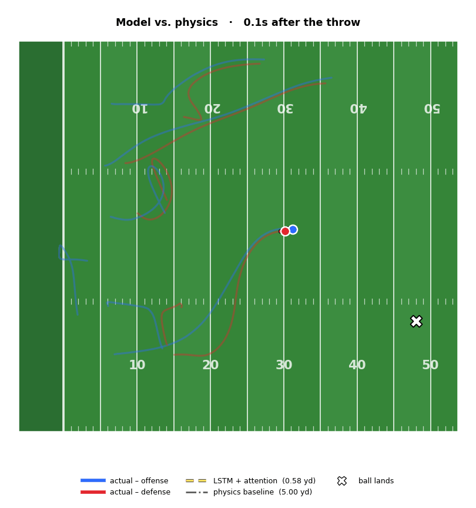
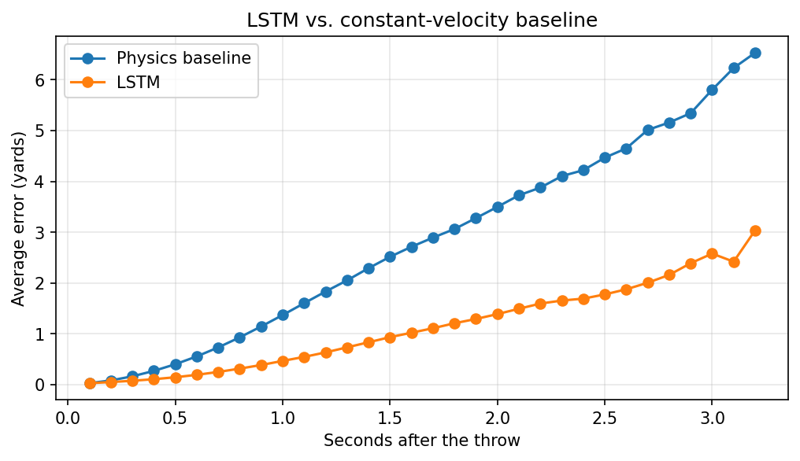
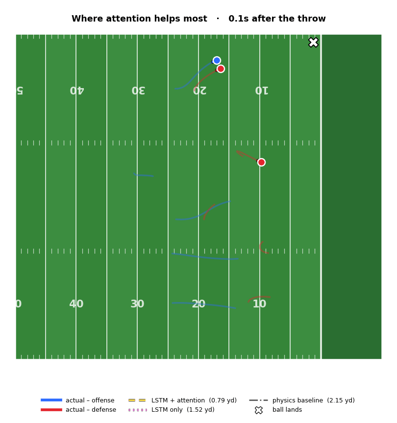
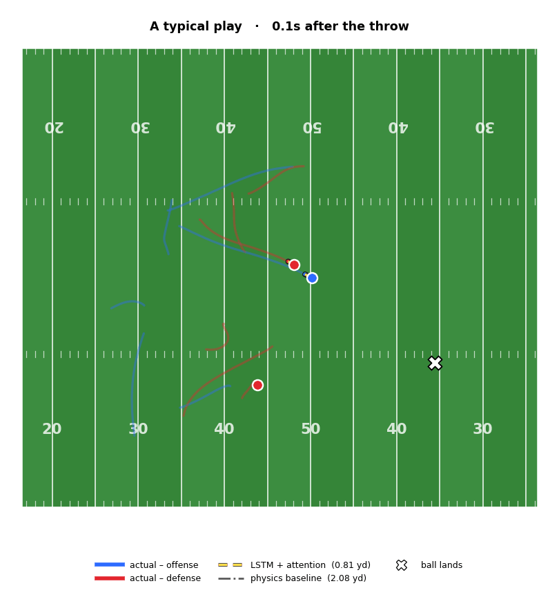
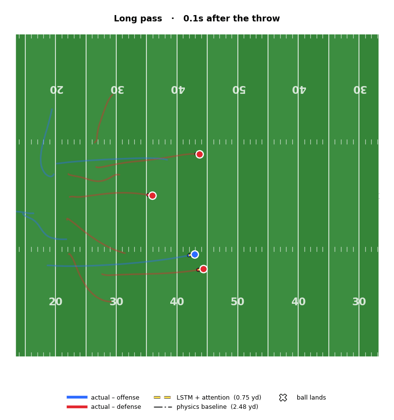
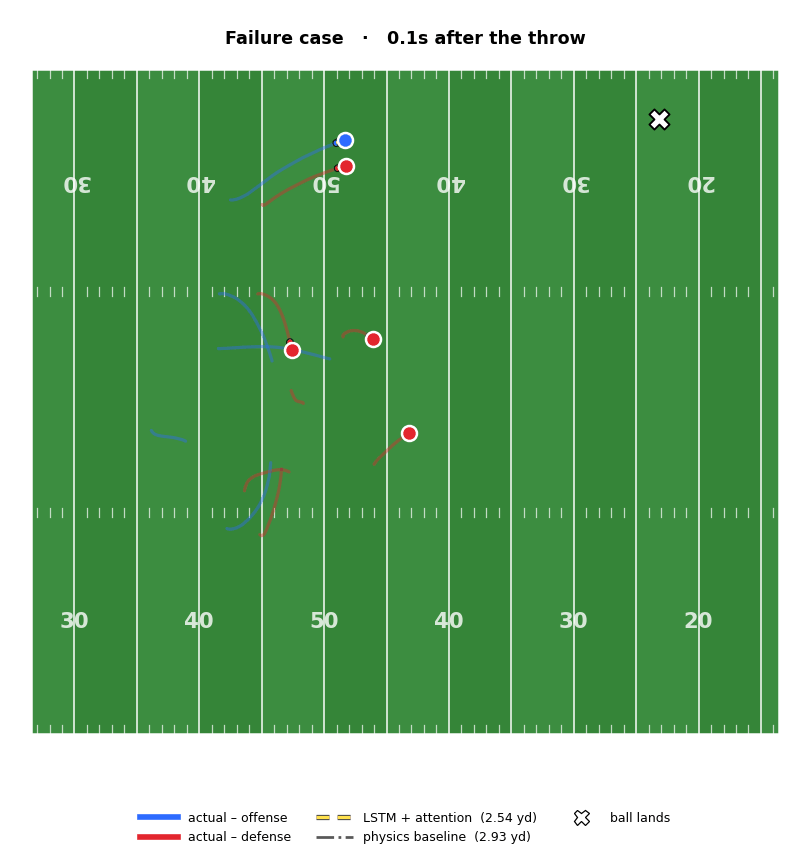

# NFL Player Trajectory Forecasting

**Predicting where receivers and defenders move while the ball is in the air, using an LSTM encoder–decoder with attention across players.**

<p align="center">
  
</p>

*Solid blue and red lines show where players actually went. The yellow dashed line is our model, and the white dash-dot line is a physics baseline that assumes every player keeps running in a straight line.*

Built for the [NFL Big Data Bowl 2026 (Prediction)](https://www.kaggle.com/competitions/nfl-big-data-bowl-2026-prediction) dataset as a CAIS++ final project.

---

## Results

Test set: weeks 17–18 of the 2023 NFL season (1,559 plays). Error is RMSE in yards, the competition metric. Neural-network results are the mean ± standard deviation over 3 independently trained models (random seeds 0–2).

| Model | All players | Offense | Defense |
|---|---|---|---|
| Physics baseline (constant velocity) | 1.706 | | |
| LSTM encoder–decoder | 0.665 ± 0.008 | 0.417 ± 0.021 | 0.742 ± 0.006 |
| **LSTM + attention** | **0.628 ± 0.011** | **0.413 ± 0.023** | **0.695 ± 0.009** |

- The LSTM cuts error **61%** compared with the physics baseline. Adding attention brings that to **63%**.
- Attention lowers defender error by **6.3%**, and it does so in every seed (6.1%, 4.9%, 8.0%). Offense shows no consistent change.
- This fits how football works. The targeted receiver runs toward where the ball lands, which the model already knows. Defenders react to the receivers around them, which only the attention layer can see.

<p align="center">
  
</p>

*Error grows the longer the ball is in the air, and the physics baseline breaks down quickly as players turn and react.*

## What the attention layer learned

Each player "attends" to every other player on the field. Attention weights show how much each one influences the player's prediction.

<p align="center">
  
</p>

We checked this across all test plays and all 3 models:

- **Defenders gave the targeted receiver 1.6–1.7× more attention** than an even split (0.14 vs. 0.08).
- **The targeted receiver was a defender's single most-attended player 40–47% of the time.** Random chance would give about 8%.
- All three independently trained models learned the same pattern.

Caveat: the defenders we predict are usually near the play, so part of this may reflect paying attention to nearby players in general, not to coverage assignments specifically.

## How it works

1. **Data:** NFL Next Gen Stats player tracking at 10 frames per second. The input is every player's movement up to the moment of the throw, plus where the ball will land. The target is each scored player's position on every frame until the ball arrives.
2. **Preprocessing:** plays are flipped so offense always moves left to right. Direction angles are encoded as sin/cos, and features are normalized using training-set statistics only.
3. **Physics baseline:** each player keeps the velocity they had over their last two frames before the throw.
4. **LSTM encoder–decoder:** the encoder reads 1 second (10 frames) of each player's history. The decoder predicts movement one frame at a time, feeding each prediction back in. Movements are added up into positions, and the loss is computed on positions.
5. **Attention upgrade:** a multi-head attention layer between the encoder and decoder lets every player look at every other player on the play, including players we don't score, who still serve as context.
6. **Evaluation:** data is split by week (train 1–14, validation 15–16, test 17–18) so plays from the same game never appear on both sides. Training uses early stopping and a learning-rate schedule. Every model is run with 3 random seeds to check that results hold up.

## Example plays

The plays are picked by category, not by hand, to show variety:

| | |
|---|---|
|  **Model vs. physics:** biggest improvement over the baseline |  **Where attention helps most:** also shows the LSTM without attention (pink dotted) |
|  **A typical play:** close to median error |  **Long pass:** the ball in the air for 3+ seconds |
|  **Failure case:** the model's worst play | |

## Run it yourself

[](https://colab.research.google.com/github/2007ethanz/nfl-trajectory-forecasting/blob/main/notebooks/nfl_trajectory_forecasting.ipynb)

1. Join the [competition on Kaggle](https://www.kaggle.com/competitions/nfl-big-data-bowl-2026-prediction) and accept the rules. Your account needs this before it can download the data.
2. Create a Kaggle API token (**Kaggle → Settings → API → Create New Token**) and add it to Colab's **Secrets** panel as `KAGGLE_API_TOKEN`.
3. Open the notebook in Colab, choose a GPU runtime, and run the cells in order. The data downloads automatically with `kagglehub`.

To run the multi-seed comparison in the background, use `src/train_nfl.py`. It saves results after every seed and skips finished seeds if it's restarted.

The dataset is not included in this repository, per Kaggle's competition rules.

## Repository layout

```
├── notebooks/nfl_trajectory_forecasting.ipynb   full pipeline: data, models, evaluation, figures
├── src/train_nfl.py                             resumable multi-seed training script
└── results/                                     GIFs and figures used above
```

## Built with

Python, PyTorch, pandas, NumPy, matplotlib

## Team

- Ethan Zhu
- *Teammate name*
- *Teammate name*
- *Teammate name*

## References

- [NFL Big Data Bowl 2026 – Prediction](https://www.kaggle.com/competitions/nfl-big-data-bowl-2026-prediction) (Kaggle)
- Vaswani et al., [*Attention Is All You Need*](https://arxiv.org/abs/1706.03762) (2017)
